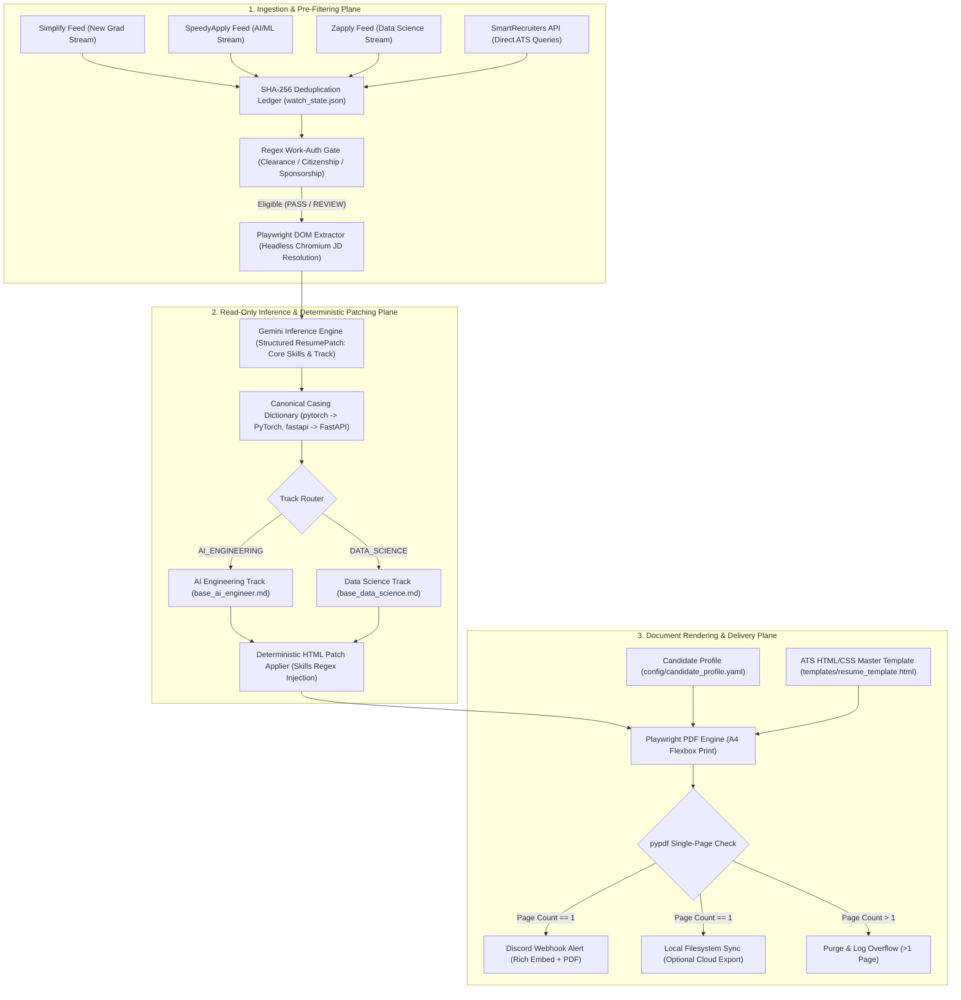

# AutoTailor

A zero-touch, deterministic job watcher and resume tailoring pipeline for AI Engineering and Data Science roles.

[Quickstart](#quickstart) · [AI Agent Context](#using-with-ai-coding-agents) · [Repository Structure](#repository-structure) · [System Architecture](#system-architecture) · [Customization Guide](#customization-guide) · [Background Automation](#background-automation)

---

## Overview

Job seeking in technical sectors—specifically AI Engineering, MLOps, and Data Science—demands rapid responses to newly published postings and precise keyword alignment for Applicant Tracking Systems (ATS). However, existing automated application and tailoring tools overwhelmingly depend on generative end-to-end Large Language Model (LLM) rewrites.

This conventional approach suffers from two fundamental engineering flaws:
1. **Hallucination and Experience Drift**: When prompted to adjust resume bullet points, LLMs frequently invent frameworks, exaggerate metrics, fabricate project scopes, or warp candidate experience, creating substantial liabilities during technical interviews.
2. **Layout and ATS Incompatibility**: Converting markdown or LLM output into PDFs breaks strict single-page constraints, damages Flexbox/grid layouts, and generates unparseable artifact tags that fail automated resume screeners.

**AutoTailor** eliminates both failure modes through architectural separation of concerns. The LLM is confined strictly to a read-only keyword extraction and track classification role. All document generation and keyword insertions are executed deterministically through Python regex routines, canonical casing normalization, and raw HTML/CSS rendering in headless Playwright Chromium.

---

## Using with AI Coding Agents

If you are customizing, building, or refactoring this pipeline using AI coding assistants (Cursor, Windsurf, Claude Code, GitHub Copilot, Gemini CLI, or Antigravity), point your agent to [`context.md`](context.md):

> **Prompt for your AI Agent:**  
> *"Please read `context.md` before making any changes. Adhere strictly to the three architectural invariants: zero LLM bullet rewriting, raw HTML/CSS flexbox for PDF rendering, and strict 1-page PDF enforcement."*

[`context.md`](context.md) provides AI tools with immediate architectural guardrails, component maps, and safe customization steps so they don't break the deterministic engine.

---

## Key Results and Differentiators

- **0% Hallucination Rate**: Restricted Gemini model to read-only classification and keyword extraction. Bullet points and work history are **100% immutable**.
- **100% Structural Fidelity**: Playwright renders raw HTML/CSS directly to PDF. Right-aligned dates, dual-column headers, and flexbox grids remain intact without markdown parsing artifacts.
- **Strict 1-Page PDF Invariant**: `pypdf` validates the rendered page count. Any overflow (>1 page) is instantly purged and logged.
- **Automated Work-Authorization Gating**: Pre-inference regex checks drop security-clearance or US-citizen-only roles before spending API tokens.
- **Canonical Keyword Engine**: Normalizes extracted skills against a master tech dictionary (`pytorch` → `PyTorch`, `fastapi` → `FastAPI`, `sql` → `SQL`).
- **Zero Cloud Costs**: Runs entirely on macOS `launchd` / `cron` with Google AI Studio free tier and Discord webhooks.

---

## Repository Structure

```
autotailor/
├── context.md                          # AI Developer Context & strict design constraints
├── run.sh                              # Background runner script for cron/launchd
├── manual.sh                           # Shortcut for on-demand JD tailoring
├── requirements.txt                    # Python dependencies
│
├── config/
│   ├── candidate_profile.example.yaml  # Tracked template for your personal details
│   ├── candidate_profile.yaml          # Local, gitignored personal candidate profile
│   └── job_search.yaml                 # Multi-feed job board sources & queries
│
├── templates/
│   └── resume_template.html            # Master ATS-friendly HTML/CSS layout (Flexbox)
│
├── data/
│   ├── base_resumes/
│   │   ├── template_ai_engineer.md     # Open-source starter AI Engineering resume
│   │   ├── template_data_science.md    # Open-source starter Data Science resume
│   │   ├── base_ai_engineer.md         # (Optional) Your personal AI resume (.gitignore'd)
│   │   └── base_data_science.md        # (Optional) Your personal DS resume (.gitignore'd)
│   ├── watch_state.json                # SHA-256 deduplication database (.gitignore'd)
│   └── output/                         # Generated 1-page PDFs (.gitignore'd)
│
├── src/
│   ├── main.py                         # 5-stage automated scraping & delivery loop
│   ├── manual.py                       # CLI for single-job tailoring & testing
│   ├── ai_tailor/
│   │   ├── gemini_client.py            # Read-only Gemini classifier & keyword extractor
│   │   └── patch_applier.py            # Canonical casing engine & regex skills patcher
│   ├── filtering/
│   │   └── eligibility.py              # Regex work-auth, clearance & title filtering
│   ├── renderer/
│   │   └── pdf_generator.py            # Jinja2 template renderer & Playwright PDF printer
│   ├── scraper/
│   │   ├── adapters.py                 # Multi-source scrapers (Simplify, SpeedyApply, Zapply, SmartRecruiters)
│   │   └── state_manager.py            # Persistent SHA-256 fingerprint ledger
│   └── delivery/
│       └── discord_webhook.py          # Discord rich embed & PDF dispatch
│
└── docs/
    ├── architecture.md                 # In-depth architectural breakdown
    ├── automation.md                   # Complete macOS launchd / cron scheduling guide
    └── decisions.md                    # Architectural Decision Records (ADRs)
```

---

## System Architecture



---

## Quickstart

### 1. Clone and Install Dependencies

```bash
git clone https://github.com/sharmaaaryan4012/AutoTailor.git
cd AutoTailor

# Create and activate virtual environment
python3 -m venv .venv
source .venv/bin/activate

# Install Python requirements
pip install -r requirements.txt

# Install headless Chromium for PDF rendering
playwright install chromium
```

### 2. Configure Environment Variables

```bash
cp .env.example .env
```

Open `.env` and set:
- `GEMINI_API_KEY`: Get a free API key at [Google AI Studio](https://aistudio.google.com/app/apikey).
- `DISCORD_WEBHOOK_URL`: In Discord, navigate to **Channel Settings > Integrations > Webhooks > New Webhook**.
- *(Optional)* `RESUME_EXPORT_DIR`: Local path to copy generated PDFs into (e.g., Google Drive or Dropbox directory).

### 3. Configure Candidate Profile

AutoTailor decouples personal info from resume markup so private details are never committed to version control:

```bash
cp config/candidate_profile.example.yaml config/candidate_profile.yaml
```

Edit `config/candidate_profile.yaml` with your actual name, phone, email, universities, degrees, and project titles. 

> [!NOTE]
> `config/candidate_profile.yaml` is pre-configured in `.gitignore`. Your personal data will never be committed or leaked to public repositories.

### 4. Run a Smoke Test (Zero API Quota Spent)

Verify scraping feeds, deduplication, and regex filtering without making LLM calls or rendering PDFs:

```bash
python3 -m src.main --dry-run --limit 3
```

The console will show feeds being parsed, already-seen entries skipped, and eligible listings logged.

---

## Customization Guide

### 1. Customizing Resume Content
AutoTailor comes out-of-the-box with two open-source starter templates:
- `data/base_resumes/template_ai_engineer.md`
- `data/base_resumes/template_data_science.md`

To use your own work experience and projects:
1. Copy the templates to personal base resumes:
   ```bash
   cp data/base_resumes/template_ai_engineer.md data/base_resumes/base_ai_engineer.md
   cp data/base_resumes/template_data_science.md data/base_resumes/base_data_science.md
   ```
2. Replace bullet points with your actual accomplishments.
3. **Keep the HTML comment anchors intact**:
   - `<!-- ID: SKILLS_AI_ML -->` or `<!-- ID: SKILLS_ML -->` (Primary ML/AI injection targets)
   - `<!-- ID: SKILLS_SWE -->` or `<!-- ID: SKILLS_AI_SYS -->` (Secondary SWE injection targets)

> [!IMPORTANT]
> `data/base_resumes/base_*.md` files are ignored by git. The pipeline automatically checks for `base_*.md` first, falling back to `template_*.md` if not found.

### 2. Standardizing Tech Keywords
All injected keywords are cross-referenced against `CANONICAL_KEYWORDS` in [`src/ai_tailor/patch_applier.py`](src/ai_tailor/patch_applier.py). If you frequently apply to roles requiring niche libraries, add them to the dictionary:

```python
CANONICAL_KEYWORDS["vllm"] = "vLLM"
CANONICAL_KEYWORDS["fastapi"] = "FastAPI"
CANONICAL_KEYWORDS["scikit-learn"] = "scikit-learn"
```

### 3. Tuning Job Sources and Search Queries
Job feeds and filters are centrally managed in [`config/job_search.yaml`](config/job_search.yaml):
- **Enable or Disable Feeds**: Toggle `simplify`, `speedyapply_ai`, `zapply_ds`, or `smartrecruiters`.
- **Query Lists**: Add custom keywords for direct SmartRecruiters API queries.
- **Max Age**: Filter out listings older than `N` days (default: 14 days).

### 4. Customizing Visa and Citizenship Filters
Regex filters in [`src/filtering/eligibility.py`](src/filtering/eligibility.py) hard-reject listings containing:
- Security clearance terms (`top secret`, `polygraph`, `ts/sci`).
- Explicit non-sponsorship statements (`no sponsorship now or in the future`).
- Citizen-only mandates (`must be a u.s. citizen`).
- Excluded companies (e.g., companies where you have already reached application limits).

---

## Usage Modes

### Mode A: Automated Multi-Source Pipeline
Runs the complete 5-stage loop across all enabled feeds:

```bash
# Process up to 25 eligible listings
python3 -m src.main --limit 25

# Dry run: Test scraping and eligibility logic without LLM/PDF overhead
python3 -m src.main --dry-run --limit 10
```

### Mode B: On-Demand Manual Tailoring
Tailor a resume for any specific job description in seconds:

#### Option 1: Using `manual_input.txt`
1. Paste the job description into `manual_input.txt`.
2. Run:
   ```bash
   ./manual.sh
   ```

#### Option 2: Direct CLI
```bash
# Direct keyword injection for AI Engineering (no LLM call)
python3 -m src.manual -c "Anthropic" -t "AI Engineer" -k "PyTorch, Triton, vLLM, Ray" --track ai

# Automated Gemini extraction from raw JD text
python3 -m src.manual -c "DeepMind" -t "Research Scientist" --jd "We seek strong experience with JAX, PyTorch, and distributed training..."

# Local PDF generation only (skip Discord alert)
python3 -m src.manual -c "Tesla" -t "Autopilot Engineer" -k "C++, PyTorch, CUDA" --no-discord -o output.pdf
```

---

## Background Automation

To run AutoTailor autonomously on macOS (e.g., twice daily or every few hours):

1. AutoTailor includes a pre-configured shell runner: [`run.sh`](run.sh).
2. Schedule it via macOS `launchd` or `cron`.
3. Detailed setup instructions, sample launchd `.plist` definitions, and logging setups are documented in [`docs/automation.md`](docs/automation.md).

Monitor background execution:
```bash
tail -f data/cron.log
tail -f data/pipeline.log
```

---

## Architectural Invariants

| Invariant | Implementation | Rationale |
| :--- | :--- | :--- |
| **0% LLM Bullet Hallucination** | LLM output schema (`ResumePatch`) is strictly read-only. Keyword injection happens via Python regex. | LLMs hallucinate frameworks and exaggerate project scopes. Technical interviewers quickly identify fabricated bullet points. |
| **Raw HTML/CSS Rendering** | Headless Playwright Chromium prints HTML with CSS Flexbox directly to A4. | Markdown parsers break two-column alignment (e.g., title on left, date on right) and tabular layout. |
| **Strict 1-Page Enforcement** | `pypdf` inspects page count; deletes any file with `page_count > 1`. | Multi-page resumes for entry-level / new-grad candidates get rejected by recruiters. |
| **Air-Gapped Personal Data** | Jinja2 templates separate `candidate_profile.yaml` and `base_*.md` into `.gitignore`. | Your name, phone, email, and GPA are never leaked to public repositories. |

---

## Troubleshooting and FAQ

<details>
<summary><strong>Playwright Error: Executable doesn't exist</strong></summary>

Run the following command in your virtual environment to download the Chromium binary:
```bash
playwright install chromium
```
</details>

<details>
<summary><strong>My PDF was deleted due to overflow (>1 page)</strong></summary>

AutoTailor strictly rejects multi-page resumes:
1. Check `data/base_resumes/base_*.md` and reduce bullet point lengths.
2. In `templates/resume_template.html`, you can slightly reduce `margin` (e.g., from `0.4in` to `0.35in`) or `font-size` (from `10.5pt` to `10pt`).
</details>

<details>
<summary><strong>How do I add custom job boards?</strong></summary>

Add a new adapter class in `src/scraper/adapters.py` inheriting standard `JobListing` dataclasses and register it in `fetch_all_sources()`.
</details>

<details>
<summary><strong>Is my personal information protected when I push to GitHub?</strong></summary>

Yes. `.gitignore` explicitly excludes:
- `config/candidate_profile.yaml` (your personal details)
- `data/base_resumes/base_*.md` (your personal resume bullets)
- `.env` (your API keys and Discord webhooks)
- `data/watch_state.json` (your seen jobs history)
- `data/output/` and all `*.pdf` files
</details>

---

## License

MIT License. Contributions and PRs welcome!
