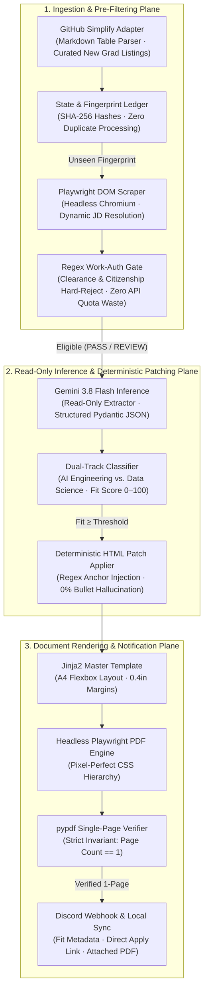

# AutoTailor

A zero-touch, deterministic job watcher and resume tailoring pipeline for AI Engineering and Data Science roles.

[Live Demo](https://www.google.com/search?q=%23) · [Documentation](https://www.google.com/search?q=%23) · [Architecture](https://www.google.com/search?q=%23)

## Overview

Job seeking in technical sectors—specifically AI Engineering, MLOps, and Data Science—demands rapid responses to newly published postings and precise keyword alignment for Applicant Tracking Systems (ATS). However, existing automated application and tailoring tools overwhelmingly depend on generative end-to-end Large Language Model (LLM) rewrites.

This conventional approach suffers from two fundamental engineering flaws:
1. **Hallucination & Experience Drift**: When prompted to adjust resume bullet points, LLMs frequently invent frameworks, exaggerate metrics, fabricate project scopes, or warp candidate experience, creating substantial liabilities during technical interviews.
2. **Layout & ATS Destruction**: Converting markdown or LLM output into PDFs breaks strict single-page constraints, damages Flexbox/grid layouts, and generates unparseable artifact tags that fail automated resume screeners.

**AutoTailor** eliminates both failure modes through architectural separation of concerns. The LLM is confined strictly to a read-only keyword extraction and track classification role. All document generation and keyword insertions are executed deterministically through Python regex routines and raw HTML/CSS rendering in headless Playwright Chromium.

## Key Results

- **Metric 1**: **100% structural fidelity** maintained via headless Playwright HTML-to-PDF rendering (no Markdown parsing artifacts, zero layout shifts).
- **Metric 2**: **0% hallucination rate** achieved by restricting Gemini 3.8 Flash to read-only keyword extraction and using Python for deterministic injection.
- **Metric 3**: **Automated 4-step execution** (Scrape, Gate, Tailor, Deliver) running natively on macOS cron with zero cloud computing costs.

## Key Features

- **Regex Work-Authorization Gating**: Instantly hard-rejects roles requiring security clearances or explicit U.S. citizenship before hitting paid APIs.
- **Dual-Track Routing**: Evaluates job descriptions to route candidates into either "AI Engineering" or "Data Science" master resumes.
- **Discord Webhook Delivery**: Pushes a consolidated alert with fit score, direct apply link, and the rendered PDF attachment directly to mobile/desktop.

## Architecture

AutoTailor is architected into three primary tiers: an ingestion and pre-filtering plane, a read-only inference and deterministic patching plane, and a high-performance document rendering and notification plane.



1. **Scraping Adapter (`src/scraper/adapters.py`)**: Fetches active job listings from curated markdown repositories and leverages Playwright to resolve JavaScript-rendered job descriptions from primary career portals.
2. **State & Fingerprint Manager (`src/scraper/state_manager.py`)**: Computes SHA-256 hashes from normalized URLs, titles, and companies to guarantee zero duplicate processing across cron runs.
3. **Regex Eligibility Gate (`src/filtering/eligibility.py`)**: Employs compiled multi-tier regex filters (`FAST_PASS`, `HARD_REJECT`, `SOFT_PASS`) to terminate postings demanding active clearances, permanent residency, or multi-year senior experience without incurring LLM inference overhead.
4. **Read-Only Gemini Inference (`src/ai_tailor/gemini_client.py`)**: Utilizes the Google GenAI SDK (`gemini-3.8-flash`) with strict Pydantic schemas to output role classification (`AI_ENGINEERING`, `DATA_SCIENCE`, `IRRELEVANT`), fit scores (0–100), and up to 5 extracted technical keywords.
5. **Deterministic HTML Patch Applier (`src/ai_tailor/patch_applier.py`)**: Identifies HTML injection anchors (e.g., `<!-- ID: SKILLS_AI_ML -->`) in master resume files, cross-references existing skills to prevent repetition, and cleanly appends matching keywords. No project or experience bullets are modified.
6. **PDF Generation & Verification (`src/renderer/pdf_generator.py`)**: Loads HTML/CSS into headless Chromium via Playwright, renders an A4 document with 0.4in margins, and validates page length using `pypdf`. Any multi-page overflow triggers immediate deletion.
7. **Delivery & Synchronization (`src/delivery/discord_webhook.py`)**: Transmits a formatted embed containing fit diagnostics, track rationale, and the compiled PDF file attachment straight to a private Discord channel.

## Design Decisions

| Decision | Rationale | Trade-off |
| :--- | :--- | :--- |
| **Read-Only LLM** | LLMs rewrite history and hallucinate bullets. Limiting Gemini to extracting keywords preserves the integrity of the candidate's actual experience. | Limits tailoring to the "Skills" section rather than dynamically reshaping project descriptions. |
| **Raw HTML/CSS** | Python Markdown parsers break tabular layouts and flexbox grids required for single-page ATS formats. | Requires writing base resumes in raw HTML rather than clean Markdown. |
| **Negative Visa Regex** | Job descriptions are inconsistent about explicitly stating sponsorship. Banning known dead-end phrases (e.g., "Top Secret", "U.S. Citizen") is highly accurate. | May occasionally require manual review for ambiguous postings flagged as "REVIEW". |

## Tech Stack

- **Languages**: Python 3.11+
- **Frameworks**: Playwright, Pydantic, Jinja2, pypdf
- **AI/Inference**: Google GenAI SDK (gemini-3.8-flash)
- **Infrastructure**: macOS Cron, Discord Webhooks

## How It Works

The automated pipeline executes periodically via a native 5-stage loop:

1. **Scrape**:
   The `SimplifyNewGradAdapter` parses fresh job commits. The `StateManager` checks `data/watch_state.json` using URL-derived fingerprints, instantly discarding previously indexed postings. Playwright visits the candidate link to capture the complete job description text.
2. **Filter**:
   The `evaluate_eligibility` engine runs regex sweeps over the raw JD text. Postings matching negative visa signals, security clearance phrases, or senior requirements (3+ years, Staff, Principal) are hard-rejected with audit records.
3. **Extract**:
   Valid postings are passed to Gemini 3.8 Flash with low temperature (`0.1`) and structured JSON schema enforcement (`ResumePatch`). Gemini routes the posting into a resume track and extracts up to 5 domain-aligned technical keywords present in the JD. Postings flagged as `IRRELEVANT` or scoring below `MIN_FIT_SCORE` are skipped.
4. **Render**:
   The engine selects the appropriate base resume (`base_ai_engineer.md` or `base_data_science.md`), injects keywords into designated skill anchors without altering experience bullets, and invokes Playwright Chromium to print the HTML file to PDF. `pypdf` validates that the resulting PDF is strictly 1 page.
5. **Notify**:
   The finalized PDF and an application card containing company, role title, fit score, and application URL are delivered via Discord Webhook. The posting fingerprint is marked as seen in persistent storage.

## Getting Started

### Prerequisites

- Python 3.11+
- Google AI Studio API Key
- Discord Webhook URL (for notifications)

### Installation

```bash
git clone https://github.com/sharmaaaryan4012/AutoTailor.git
cd AutoTailor
python3 -m venv .venv
source .venv/bin/activate
pip install -r requirements.txt
playwright install chromium
```

### Configuration

Create a `.env` file based on `.env.example`:

```env
GEMINI_API_KEY="your_api_key"
DISCORD_WEBHOOK_URL="your_webhook"
```

Place your base HTML resumes in `data/base_resumes/base_data_science.md` and `data/base_resumes/base_ai_engineer.md`.

### Run

Run the pipeline synchronously:

```bash
python3 -m src.main --limit 10
```

Verify pipeline behavior without consuming Gemini API tokens or rendering PDFs:

```bash
python3 -m src.main --dry-run --limit 5
```

## Limitations and Future Work

- Currently relies on Simplify's GitHub repository as the primary clean data source; expanding custom scrapers requires managing individual site anti-bot measures.
- Will eventually migrate to an MCP (Model Context Protocol) server architecture if expanded to support fully automated application submission.

## Status and Contributions

Active development project built for personal recruiting infrastructure. Contributions and forks welcome.

## License

MIT License

